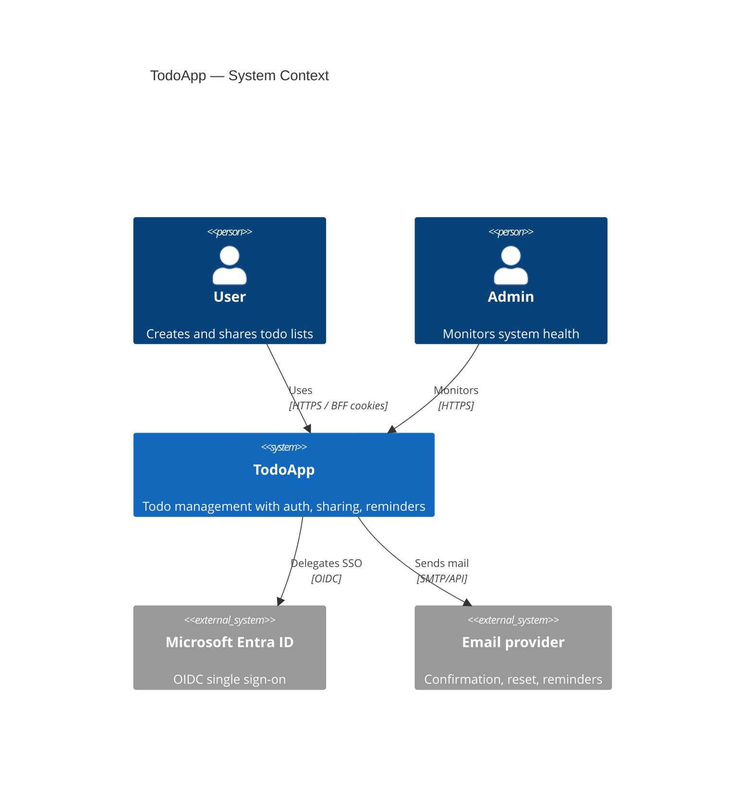
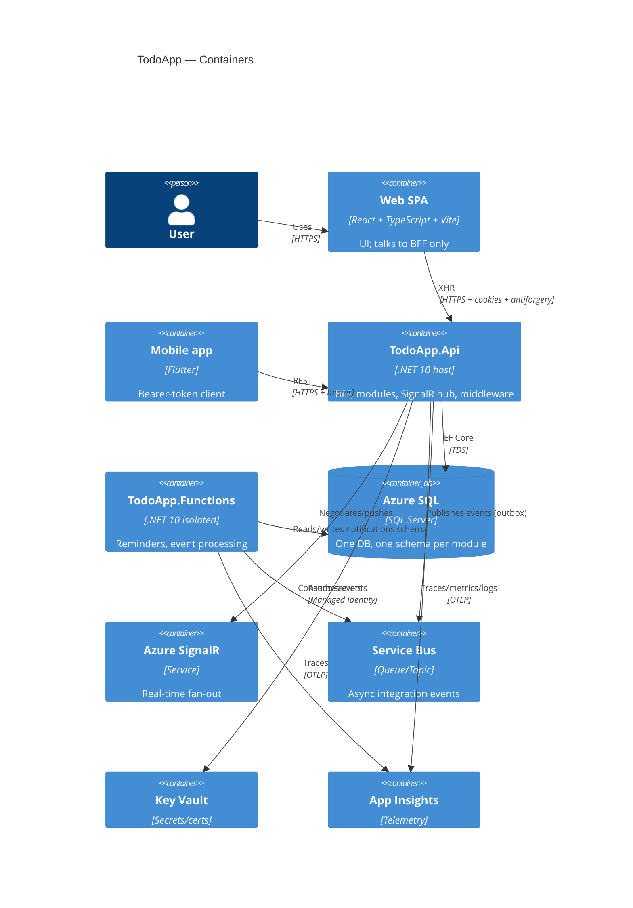

# Architecture overview

TodoApp is a **modular monolith**: one deployable host (`TodoApp.Api`) composing
independent modules, designed so any module can later be extracted into its own service
with minimal change (see [ADR 0001](../decisions/0001-modular-monolith.md)).

## C4 — Level 1: System context

## C4 — Level 2: Containers

## Request flow (web, BFF)
1. Browser sends XHR to `TodoApp.Api` with the auth cookie + antiforgery token.
2. Correlation-id middleware assigns/propagates `X-Correlation-Id` (Phase 4).
3. Auth middleware resolves the user from the cookie; policies authorize.
4. The matched module endpoint executes application logic; EF Core hits its schema.
5. Side effects enqueue integration events to the module **outbox** (same transaction).
6. The outbox dispatches events (in-process now, Service Bus by config) → consumers / SignalR.
7. Response returns with `X-Correlation-Id`; telemetry is emitted via OpenTelemetry.

## Cross-cutting
- **BuildingBlocks** supplies `Result`, event base types, the outbox, and observability helpers.
- **Boundaries are enforced** by `tests/TodoApp.ArchitectureTests` (fails the build on violation).
- Modules: see [modules.md](./modules.md). Auth: see [../auth/auth-flows.md](../auth/auth-flows.md).
  Observability: see [../observability/monitoring.md](../observability/monitoring.md).
